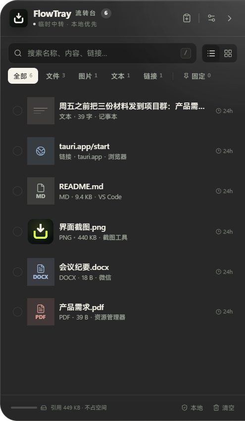
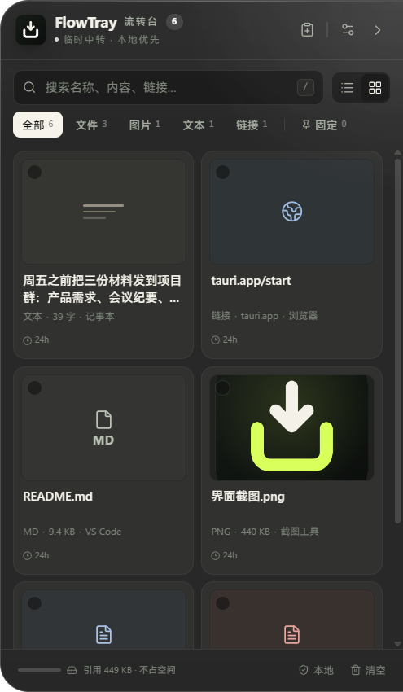

# FlowTray 流转台

> 拖入即流转，用完即清理。

FlowTray 是一个 Windows 桌面文件「中转坞」：把文件、文件夹、图片、文本、链接从资源管理器、浏览器或聊天窗口拖到屏幕侧边暂存，稍后再拖到另一个应用、批量复制或直接打开，到期自动清理。没有账号、没有云端、没有遥测。

基于 **Tauri 2 + Rust + React 19**，单个 exe，使用系统 WebView2 运行时。




## 功能

- **唤出**：托盘常驻、贴左/贴右、置顶、拖边缘悬停唤出（先出现 32×180 提示条，停留后展开）；再次运行 exe 会唤出已运行实例；可拖拽调整宽高。
- **拖入收集**：文件、文件夹、图片、文本、URL，支持多选一次拖入；拖入高亮；`Ctrl` 临时把复制切换为剪切（可改键或反转默认）。
- **文件夹合集**：拖入文件夹时自动展开它的一级子项（上限 100），收进「文件夹：X」合集卡；点开进入二级视图，与「剪贴板合集」交互一致。
- **卡片信息**：类型、缩略图/类型牌、名称、大小、来源、时间、到期、固定状态；列表/网格两种视图；搜索、类型筛选、固定筛选、失效筛选。
- **多选与批量**：点选、Ctrl 点选、Shift 连选、全选、批量复制、复制路径、固定、删除。
- **拖出使用**：原生 `DoDragDrop`，可直接拖到资源管理器、微信、邮件、浏览器；文本/图片可复制到系统剪贴板；双击打开，右键定位或查看信息。
- **生命周期**：默认 24 小时过期（1h / 24h / 7d / 永不）；固定项不清理；到期提醒；容量上限；启动时恢复、清理过期并标记失效文件。
- **存储策略**：默认只记「路径 + 缩略图」，不复制大文件；可切换为复制副本；源文件移动/删除后可重新定位。
- **设置**：深色/浅色分别配置背景色与强调色（支持十六进制输入）；开机自启、管理员启动、存储目录迁移、清除数据、导出设置配置。
- **隐私**：全本地；剪贴板监听默认关闭并可排除敏感应用；日志脱敏；一键清除数据。

## 技术栈

| 层 | 选择 |
| --- | --- |
| 桌面壳 | Tauri 2.12（Rust 2021，`windows` crate 直接调用 Win32 / OLE / COM） |
| 前端 | React 19 + Vite 7 + Zustand，样式为原生 CSS 设计系统 |
| 存储 | `rusqlite`（bundled SQLite，WAL），数据默认在 `%APPDATA%\FlowTray` |
| 拖出 | 自建 `IDataObject` + `DoDragDrop`（`drag_payload.rs` / `drag_native.rs`） |
| 拖入 | 自研 `IDropTarget`（`drop_target.rs`），注册到悬浮窗与全部 WebView2 子窗口 |
| 剪贴板 | Win32 `CF_UNICODETEXT` / `CF_HDROP` / `CF_DIB` / PNG / HTML Format |

## 环境要求

- Windows 10 22H2+ / Windows 11，系统带有 **WebView2 运行时**（Win11 自带）
- Node.js 20+ 与 pnpm（或 npm）
- Rust 1.77+ 与一个 C 工具链（`rusqlite` bundled 需要编译 SQLite）
- 若要给 exe 内嵌图标/版本资源，还需要 `windres`（MSYS2 的 `mingw-w64-x86_64-binutils` 或 Windows SDK 里的 `rc.exe`）

## 从源码构建

本项目在 Windows 上默认使用 **GNU 工具链**（无需管理员权限安装 MSVC）：

```powershell
# 1) Rust（GNU host）
rustup-init -y --default-host x86_64-pc-windows-gnu --profile minimal
# 2) MinGW-w64（提供 gcc / windres / dlltool），例如 MSYS2：
#    pacman -S mingw-w64-x86_64-gcc mingw-w64-x86_64-binutils
# 3) 前端依赖
pnpm install            # 或 npm install
pnpm build              # tsc 类型检查 + vite 打包，产物在 dist/
# 4) 打包成单文件 exe（前端资源内嵌）
cargo build --release --manifest-path src-tauri/Cargo.toml --features custom-protocol
# 产物：src-tauri/target/x86_64-pc-windows-gnu/release/flowtray.exe
```

开发模式：先 `pnpm dev`（Vite 端口 1420），再用 `cargo run --manifest-path src-tauri/Cargo.toml`（不带 `custom-protocol`）启动，窗口会加载开发服务器。

> 使用 MSVC 工具链时目标路径为 `src-tauri/target/release/flowtray.exe`。

## 数据位置

- 默认：`%APPDATA%\FlowTray`（数据库 `flowtray.db`、`storage\`、`logs\`、WebView2 配置 `webview\`）。
- 便携模式：程序目录下存在 `FlowTray.portable` 时，全部数据写到 `<程序目录>\data`，卸载删目录即可。
- 环境变量 `FLOWTRAY_USER_DATA=<目录>` 可临时指定数据目录。

打包成安装程序的注意事项见 [`docs/05-app-folder.md`](docs/05-app-folder.md)。

## 项目结构

```
src/                    前端（React）
  api/index.ts          Tauri 桥接层：实现 window.flowtray（invoke / listen）
  App.tsx               浮层路由、键盘、拖入处理
  components/           卡片、设置面板、引导、详情、菜单…
  shared/               类型、设置 schema、格式化、主题
  styles/               设计系统与页面样式
src-tauri/              Rust 后端
  src/main.rs           入口、单实例、窗口创建、事件循环
  src/app.rs            全局状态、快照、广播、撤销
  src/commands.rs       Tauri 命令
  src/items.rs          领域核心：入库、去重、复制、失效、到期、视图
  src/clipboard.rs      Win32 剪贴板读写与监听
  src/drag_out.rs       拖出流程（暂存、看门狗、兜底）
  src/drag_native.rs    UI 线程上的 DoDragDrop 会话
  src/drag_payload.rs   自建 IDataObject（CF_HDROP / CF_TEXT / DropEffect）
  src/drag_landing.rs   拖到桌面等场景的落点处理
  src/drop_target.rs    自研 OLE IDropTarget 拖入
  src/window.rs         悬浮窗几何 / 显隐 / 边缘 peek
  src/tray.rs           托盘菜单与提示
  src/db.rs / settings.rs / paths.rs / fsx.rs / thumbs.rs   基础设施
docs/                   架构、测试计划、打包说明
tests/unit/             前端单元测试（Vitest）
tests/e2e/              基于 WebView2 远程调试（CDP）的验收脚本
```

## 测试

```powershell
pnpm test                                          # 前端单元测试
cargo test --manifest-path src-tauri/Cargo.toml    # Rust 单元测试
bash tests/e2e/run-acceptance.sh                   # 端到端验收（需先构建一次）
```

端到端验收通过 CDP 驱动真实界面完成，覆盖引导、文本/文件/链接入库、去重、复制、固定、清空撤销、设置校验、删除与渲染；记录见 [`docs/04-test-plan.md`](docs/04-test-plan.md)。

## 已知限制

- **未签名**：Windows SmartScreen 会提示「未知发布者」。
- **管理员边界**：Windows UIPI 阻止普通权限程序与管理员程序互相拖放；设置里提供「以管理员身份重启」。
- **拖出语义**：目标应用对暂存副本执行「移动」不影响原文件；跨磁盘或超大文件夹会退化为原路径并提示。
- **缺少 `windres` 时**：exe 不会内嵌图标与版本资源（窗口/托盘图标仍在运行时设置）。
- **通知**：使用应用内 Toast 与自动浮现窗口，不经过系统通知中心。

## License

[MIT](LICENSE)
